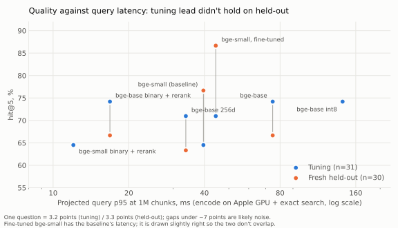
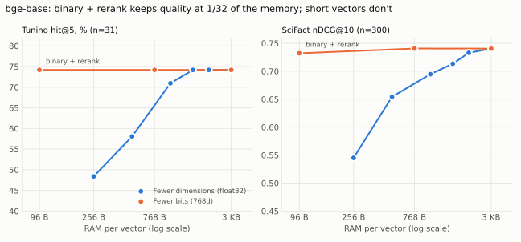

# embedding-model-bench

**The client question:** which embedding model should we use for our documents, and is fine-tuning worth it?

The documents are 20 Terms of Service and privacy policies (10 companies, 1,581 section chunks) from [Fine Print](https://github.com/srikantl50193-dev/fine-print), a question-answering app over policies. Everything ran locally on a 16 GB M1 Pro for free.

## The answer

**Stay on `bge-small-en-v1.5` for now. The evidence doesn't support paying for `bge-base-en-v1.5`.**

- `bge-base` led on the tuning questions (23/31 against 20/31) and on SciFact. On the 30 fresh held-out questions it scored **20/30 against `bge-small`'s 23/30**, and on Fine Print's older held-out set 15/20 against 17/20. It costs 3.3× the model size, 2.6× the time to embed, and 1.5–3× the query latency.
- **Fine-tuning is unproven.** Fine-tuned `bge-small` gained 2 tuning questions (noise), lost significantly on SciFact, and scored best on the fresh held-out set (26/30). That set was written in a way that may favour it, as explained below. It did no better on Fine Print's older held-out set (16/20 against 17/20).
- **What does work: binary vectors with a float32 rerank.** This stores each vector as 1 bit per dimension and searches those bits, then reorders the top 40 candidates using the full float32 vectors kept on disk. For both models it **found the same tuning questions in its top 5 as float32 (0 wins, 0 losses), at about 32× less memory**. For `bge-small` it ranked some of them a little lower (MRR 0.597 against 0.618). At a million chunks it searches in 3.7 ms instead of 62 ms for `bge-base`, and needs 96 MB of RAM instead of 3.1 GB. It is the change worth making once the corpus grows, whichever model is used.

Every gap between models here is within noise: 20–31 questions per set can't separate them. The next step is a bigger, human-written evaluation set (see [Next steps](#next-steps)).

## Results at a glance

| Configuration | Tuning hit@5 (n=31) | Fresh held-out hit@5 (n=30) | Fine Print held-out hit@5 (n=20, used before) | SciFact nDCG@10 (n=300) | RAM at 1M chunks | Query p95 at 1M chunks, projected (Apple GPU) | Time to embed 1M chunks, projected (Apple GPU) |
| --- | --- | --- | --- | --- | --- | --- | --- |
| **bge-small (current baseline)** | 20 | **23** | **17** | 0.713 | 1.5 GB | 40 ms | 2.2 h |
| bge-small, binary + rerank | 20 | not run | not run | 0.692 | **48 MB** | **12 ms** | 2.2 h |
| bge-small, fine-tuned | 22 | 26 | 16 | 0.685 | 1.5 GB | 40 ms | 2.2 h |
| bge-base | 23 | 20 | 15 | 0.740 | 3.1 GB | 75 ms | 5.7 h |
| bge-base, binary + rerank (frozen recommendation) | 23 | 20 | 15 | 0.732 | 96 MB | 17 ms | 5.7 h |
| bge-base, 256 dimensions | 22 | 19 | 17 | 0.695 | 1.0 GB | 34 ms | 5.7 h |

- **"hit@5"** is Fine Print's measure: a question counts if a chunk in the top 5 comes from the right document and contains every keyword the answer needs.
- **RAM** is for the vectors alone. Binary + rerank also keeps the float32 vectors on disk, for the rerank: 1.6 GB for `bge-small` and 3.2 GB for `bge-base` at a million chunks.
- **Query p95** adds the measured time to encode one query to the measured search time, using exact search on one thread. Search was timed over corpora built by repeating the real vectors.





## The frozen recommendation, and what held-out said

Before any held-out question was scored, I committed [`results/recommendation_frozen.md`](results/recommendation_frozen.md). Based on tuning, SciFact and the measured costs, it recommended **`bge-base` with binary + rerank, and no fine-tuning**. The held-out sets were then run once, and **they contradict it.**

The fresh held-out set has 30 questions, frozen before any benchmark and never used before. Every comparison is against `bge-small`:

| Configuration | hit@1 | hit@5 | hit@10 | MRR | Wins / losses at hit@5 | Sign test p |
| --- | --- | --- | --- | --- | --- | --- |
| bge-base | 7 | 20 | 23 | 0.418 | 1 / 4 | 0.38 |
| bge-base, binary + rerank (recommended) | 7 | 20 | 23 | 0.418 | 1 / 4 | 0.38 |
| bge-base, 256 dimensions | 6 | 19 | 23 | 0.388 | 1 / 5 | 0.22 |
| bge-small, fine-tuned | 15 | 26 | 28 | 0.653 | 3 / 0 | 0.25 |
| bge-small (baseline) | 12 | 23 | 25 | 0.557 | - | - |

Fine Print's own held-out set has 20 questions. It was already scored for Fine Print's v2 and v3, so it's reported separately and isn't a clean estimate:

| Configuration | hit@1 | hit@5 | hit@10 | MRR | Wins / losses at hit@5 | Sign test p |
| --- | --- | --- | --- | --- | --- | --- |
| bge-base | 10 | 15 | 17 | 0.610 | 0 / 2 | 0.50 |
| bge-base, binary + rerank (recommended) | 10 | 15 | 17 | 0.611 | 0 / 2 | 0.50 |
| bge-base, 256 dimensions | 9 | 17 | 17 | 0.574 | 1 / 1 | 1.00 |
| bge-small, fine-tuned | 10 | 16 | 19 | 0.625 | 2 / 3 | 1.00 |
| bge-small (baseline) | 12 | 17 | 18 | 0.692 | - | - |

- **Wins / losses** count questions only one of the two models found in its top 5. The sign test asks whether that split could be chance. No held-out comparison comes close to significance: one question moves a score by 3.3 points on the fresh set and 5 points on the older one.
- **The frozen recommendation wasn't changed.** The answer at the top is a different, later conclusion: with held-out in, the evidence no longer supports switching away from `bge-small`.
- **The selection rule fixed before any results** would have picked fine-tuned `bge-small` on a mechanical tie-break: it was within two questions of the best tuning score and had the smallest model. The frozen note explains why I departed from that before held-out, and held-out ended up favouring the rule's literal pick on the fresh set.

### Caveat: who wrote the questions

- **The fresh held-out set was written by Claude, an LLM**, from randomly sampled chunks: [`eval/fresh_holdout/README.md`](eval/fresh_holdout/README.md) describes how.
- **The fine-tuning data was made the same way:** `gemma4:e4b`, also an LLM, wrote questions from chunks, including the ones the fresh questions came from.
- **What leakage filtering did:** synthetic questions close to any eval question were dropped (427 of them, 174 of them close to fresh held-out questions). So the model never trained on the fresh questions themselves.
- **What it couldn't remove:** questions written by an LLM from a chunk share a style, and the fine-tuned model learned that style. That may explain why it led on the fresh set but not on Fine Print's older set, whose questions were written differently.

This is a possible explanation, not a reason to discount the result. Settling it needs questions written by people.

## Everything else that was measured

### Six models (tuning n=31, SciFact n=300)

| Model | Tuning hit@5 | Wins / losses vs bge-small | MRR | SciFact nDCG@10 | MTEB SciFact | Chunks/s (Apple GPU) | Query p95 (GPU / CPU) | Weights |
| --- | --- | --- | --- | --- | --- | --- | --- | --- |
| bge-small-en-v1.5 | 20 | - | 0.618 | 0.713 | 0.713 | 125 | 8.8 / 11.6 ms | 127 MB |
| bge-base-en-v1.5 | 23 | 3 / 0 (p 0.25) | 0.596 | 0.740 | 0.743 | 49 | 13.1 / 34.2 ms | 418 MB |
| snowflake-arctic-embed-m-v1.5 | 20 | 1 / 1 | 0.587 | 0.716 | 0.718 | 49 | 13.2 / 32.1 ms | 415 MB |
| e5-base-v2 | 19 | 1 / 2 | 0.587 | 0.719 | 0.719 | 48 | 14.2 / 33.4 ms | 418 MB |
| nomic-embed-text-v1.5 | 18 | 0 / 2 | 0.525 | 0.703 | 0.703 | 48 | 16.2 / 38.3 ms | 522 MB |
| granite-embedding-small-english-r2 | 13 | 0 / 7 (p 0.02) | 0.360 | 0.744 | 0.755 | 150 | 9.0 / 13.1 ms | 91 MB |

- **The pipeline checks out against published results.** The baseline reproduces Fine Print's published tuning scores exactly, and every model's SciFact score is within 0.011 of the public MTEB result.
- **Every model ran in float32, with the prefixes its model card specifies.** Timings were taken with no competing apps open, as the median and 95th percentile of 155 single queries.
- **EmbeddingGemma was planned but replaced by `e5-base-v2`**, because it needs a Hugging Face login. Nomic ran without `trust_remote_code`: current transformers supports it natively.

### What else turned up

- **Prefixes:** keep each model card's prefixes. Only Arctic depends on its own: without it, SciFact nDCG@10 falls from 0.716 to 0.365 (0 wins, 109 losses). Nothing would crash, so retrieval would just silently get much worse. No other combination beat the card by more than noise. Details are in [`results/prefixes/`](results/prefixes/summary.md).
- **Granite:** it is weak on these documents, and the keyword test isn't the reason. I read every miss by hand for three models. The test undercounts all of them by 3–5 questions, and Granite still trails by 9 or more. It tends to return a document's contact or introduction sections instead of the passage that answers. Details are in [`results/misses/hand_read.md`](results/misses/hand_read.md); I wrote that read-through and wasn't blind to which model was which.
- **Shorter vectors (Matryoshka):**
  - `bge-base` keeps 23/31 down to 384 dimensions and 22/31 at 256, but SciFact falls steadily (0.740 to 0.695 at 256, with 3 wins and 23 losses).
  - Arctic and Nomic, which were trained to be shortened, did no better than `bge-base`, which wasn't.
  - Binary + rerank is the better way to save memory. Details are in [`results/matryoshka/`](results/matryoshka/summary.md).
- **Quantization:**
  - int8 costs no quality, but in FAISS's exact search it is twice as slow as float32.
  - Binary vectors alone lose clearly on SciFact (2 wins, 28 losses for `bge-base`).
  - Binary + rerank is close to float32: SciFact 0.732 against 0.740 (2 wins, 3 losses) for `bge-base`, and 0.692 against 0.713 (4 wins, 10 losses, p 0.18) for `bge-small`. Details are in [`results/quantization/`](results/quantization/summary.md).
- **Duplicates in the corpus:** 43 Lyft chunks are identical in its terms and its privacy policy, and a few more repeat for Strava, Coursera, Reddit and Pinterest.
  - **What they affect:** identical chunks tie on score, so the tie-break decides two Lyft questions.
  - **How this project handles them:** ties always go to the earlier chunk. Reversing that changes no model's hit@5, and moves every model's MRR by about 0.03.
  - **Recommendation for Fine Print:** remove duplicates when it ingests documents. Details are in [`results/data/duplicate_chunks.md`](results/data/duplicate_chunks.md).

### Fine-tuning

| Model | Tuning hit@5 (n=31) | Wins / losses | MRR | SciFact nDCG@10 | SciFact wins / losses |
| --- | --- | --- | --- | --- | --- |
| bge-small (baseline) | 20 | - | 0.618 | 0.713 | - |
| fine-tuned on all 10 companies | 22 | 3 / 1 (p 0.63) | 0.603 | 0.685 | 5 / 16 (p 0.03) |
| fine-tuned without Discord, Spotify and Zoom | 22 | 3 / 1 | 0.603 | 0.686 | 5 / 9 |

- **Training data:**
  - `gemma4:e4b` on Ollama wrote 2 questions for each of the 1,520 distinct chunks, 3,036 in total, in 67 minutes.
  - Filters removed questions that leaked from eval sets (427) and questions whose source chunk the baseline couldn't find in its top 100 (236).
  - That left 2,124 training and 249 validation examples, split by chunk.
  - Hard negatives came from the baseline's top 30, skipping the source, copies of it, chunks overlapping it, and near-ties that might also answer the question.
- **Training:**
  - Loss: MultipleNegativesRankingLoss in its cached form, batch 32, learning rate 2e-5.
  - Early stopping on validation nDCG@10, which rose from 0.535 to 0.661 and peaked at step 198.
  - About 12 minutes on the Apple GPU.
- **Unseen companies (rough signal, 9 questions):** a model trained without Discord, Spotify and Zoom scored 5/9 on their questions, the same as the baseline. So did the model trained on all 10 companies.

### Cost at scale

All figures are for exact search on one thread. Query and embedding times are projections from the measured parts, as described under the results table.

| Configuration | RAM, 100k / 1M chunks | Search p95, 100k / 1M | Embedding time for 1M, Apple GPU / CPU |
| --- | --- | --- | --- |
| bge-small float32 | 154 MB / 1.5 GB | 3.3 / 31 ms | 2.2 / 4.0 h |
| bge-small binary + rerank | 5 / 48 MB | 0.4 / 3.3 ms | 2.2 / 4.0 h |
| bge-base float32 | 307 MB / 3.1 GB | 6.4 / 62 ms | 5.7 / 9.6 h |
| bge-base int8 | 77 / 768 MB | 13 / 129 ms | 5.7 / 9.6 h |
| bge-base binary + rerank | 10 / 96 MB | 0.5 / 3.7 ms | 5.7 / 9.6 h |
| bge-base 256 dimensions | 102 MB / 1.0 GB | 2.2 / 21 ms | 5.7 / 9.6 h |

Up to 100,000 chunks, any of these is fast enough. Past that, binary + rerank is what keeps search quick and memory small. Details are in [`results/cost/`](results/cost/summary.md).

## Plugged into Fine Print

The whole Fine Print pipeline was run with each model on its tuning set: retrieval, the refusal threshold, and `gemma4:e4b` answering with citations. This was on the unmerged branch `experiment/embedding-models`, in a separate worktree. Fine Print's held-out set is spent and wasn't used. The full table, with answer latency, is in that branch's `docs/embedding_experiment_results.md`.

| Embedding model | min_similarity | Retrieval recall@5 | Correct citation (n=31) | Wins / losses vs bge-small | Out-of-scope refused (n=15) | Answerable wrongly refused |
| --- | --- | --- | --- | --- | --- | --- |
| bge-small (current) | 0.6 | 20 | 20 | - | 15 (8 by threshold, 7 by Gemma) | 1 (by Gemma) |
| bge-base | 0.6 | 23 | 22 | 2 / 0 (p 0.50) | 15 (9 / 6) | 1 (by Gemma) |
| bge-small, fine-tuned | 0.6 | 22 | 16 | 0 / 4 (p 0.12) | 15 (15 / 0) | 5 (4 by threshold, 1 by Gemma) |
| bge-small | 0.738, re-tuned* | 20 | 19 | - | 15 (15 / 0) | 3 (2 by threshold, 1 by Gemma) |
| bge-base | 0.655, re-tuned* | 23 | 20 | 1 / 0 (p 1.00) | 15 (15 / 0) | 2 (1 by threshold, 1 by Gemma) |
| bge-small, fine-tuned | 0.571, re-tuned* | 22 | 19 | 2 / 2 (p 1.00) | 15 (15 / 0) | 3 (2 by threshold, 1 by Gemma) |

\* **Re-tuned thresholds were chosen on these same questions and scored on them, so they are optimistic.** The rule, fixed before any similarity was seen, picks the threshold that sorts the most tuning questions correctly by similarity alone.

- **The baseline reproduces Fine Print's published figure:** 20/31 correct citations, or 65%. Each model's retrieval recall@5 matches what this project measured, using Fine Print's own Chroma index.
- **`bge-base` at 0.6 gains 2 correct citations**, which is noise on 31 questions. That's consistent with keeping `bge-small`.
- **Fine-tuning shifted the model's similarity scores.** At 0.6, the threshold turned away 4 answerable questions, leaving 16/31 correct citations. A fine-tuned model needs its threshold recalibrated before it can be compared fairly; re-tuned, it reached 19/31.
- **Raising the threshold didn't help.** At 0.6, Gemma already declines every out-of-scope question that gets past the threshold. Re-tuning on similarity alone pushed `bge-small` to 0.738, very close to the highest out-of-scope score (0.736). That added two wrong refusals and caught nothing new. So Fine Print should keep 0.6 for `bge-small`, and any future re-tuning should count the model's own refusals.

## How it was evaluated

- **Choosing used the tuning set only.** That's Fine Print's 31 questions, plus SciFact as an out-of-domain check. The held-out sets were run once, at the end, for the five final configurations, and are reported as they came out.
- **The selection rule was fixed before any results.** The highest tuning hit@5 wins, and among configurations within two questions of it, the smaller and faster one wins. The frozen recommendation records where I departed from the rule's mechanical tie-break, and why.
- **Every result comes with its n**, with question-by-question wins and losses and an exact sign test, because single scores on 20–31 questions hide how noisy they are.
- **Leakage:** no eval question could enter training. Synthetic questions were dropped if they matched any eval question exactly, by embedding similarity of 0.80 or more, or by sharing half their content words. Held-out questions were compared but never printed or stored.
- **Thresholds were revised once, before training, after reading samples of the first pass** (training data and tuning-set pairs only):
  - The leakage cutoff tightened from 0.85 to 0.80, because near-copies were getting through. Being stricter can only remove training data.
  - The round-trip cutoff widened from the top 20 to the top 100, because good questions the baseline ranked poorly were being dropped.
- **Fine Print stayed read-only throughout.** Its data is read through symlinks, and every step checks that its files are unchanged.

## Limitations

- **Small question sets:** with 20–31 questions per set, a 3-question gap isn't significant, so no model comparison here is conclusive.
- **Who wrote the eval questions:** the fresh held-out set was written by an LLM, and so were the training questions. No eval set was written by an independent person for this project.
- **Keyword relevance:** a correct answer phrased differently counts as a miss. The hand read suggests this undercounts every model by 3–5 questions.
- **One corpus, one machine:** results are for 20 English policies on one M1 Pro. Latency at scale is for exact search on one thread; an approximate index (HNSW) in a vector database would change the million-chunk figures.
- **Projections:** query latency at scale adds two separately measured 95th percentiles, so it is conservative. Embedding time is throughput extrapolated to a million chunks.

## Next steps

1. **A human-written evaluation set**, ideally 100 or more questions written by someone other than us. That is the only way to separate these models.
2. **Real user queries**, if the client has them: they are the best test of all.
3. **Then re-test fine-tuning** on that set, with training questions written in a different way from the eval questions.
4. **Adopt binary + rerank** once the corpus passes about 100,000 chunks, and test it alongside an approximate index (HNSW) in the vector store the client will use.
5. **Remove duplicate chunks** when Fine Print ingests documents.
6. **Recalibrate `min_similarity` with the model in the loop** whenever the embedding model changes, counting the model's own refusals rather than similarity alone.

## Process notes

- **A caching bug in the held-out run:** the first attempt stopped before scoring anything. The embedding step had cached both held-out sets as one combined list, which the cache keys differently from each set alone, so scoring found nothing. Scoring is built to stop rather than load a model, so it did. No held-out number was produced or seen. The fix (`f5123bd`) embeds each set separately, a test now covers two sets, and the run was then done once.
- **Memory during fine-tuning:** standard MultipleNegativesRankingLoss at batch 32 exhausted this 16 GB machine. Training used the cached form of the loss (the same loss computed over the full batch, with less memory), mini-batches of 8, eager attention (Apple GPU fused attention can't apply dropout), and a capped, regularly emptied GPU memory pool.
- **Timings were remeasured:** the first benchmark timings were taken with Chrome open, so all of them were measured again on a clean machine before being reported.
- **A refactor partway through:** after the experiments, the code was refactored. Every stored result was recomputed from cached vectors and matched exactly.

## Reproduce

```bash
git clone https://github.com/srikantl50193-dev/fine-print ../fine-print   # the corpus and chunker
make setup && make data
make benchmark prefixes matryoshka quantization     # timing steps: close other apps first
make generate-sample && make generate               # needs Ollama with gemma4:e4b; resumable
make prepare-training finetune cost
uv run emb-bench holdout --tuning-check             # the held-out run itself has already happened
uv run --group docs python scripts/make_charts.py
```

`make check` runs lint, type checks and tests. The tests use tiny fakes and never download a model. [CLAUDE.md](CLAUDE.md) records the project's rules and status.

## Credits

- **Corpus:** policies collected through Fine Print from [ToS;DR](https://tosdr.org) and [Open Terms Archive](https://opentermsarchive.org).
- **Out-of-domain benchmark:** SciFact from [BEIR](https://github.com/beir-cellar/beir). Thakur, Reimers, Rücklé, Srivastava and Gurevych, "BEIR: A Heterogeneous Benchmark for Zero-shot Evaluation of Information Retrieval Models", NeurIPS 2021 Datasets and Benchmarks Track.
- **Models:** BAAI (bge), Snowflake (arctic-embed), Microsoft (e5), Nomic AI (nomic-embed), IBM (granite-embedding), and Google's Gemma 4 served by Ollama. Each was used at a pinned revision, listed in `registry.py`.
- **Libraries:** sentence-transformers, FAISS and MTEB's published results.

### Licences

| What | Licence |
| --- | --- |
| bge-small-en-v1.5, bge-base-en-v1.5 (BAAI), e5-base-v2 | MIT |
| snowflake-arctic-embed-m-v1.5, nomic-embed-text-v1.5, granite-embedding-small-english-r2 | Apache 2.0 |
| Gemma 4 (`gemma4:e4b`), used to write the synthetic training questions | Apache 2.0 |
| SciFact (BEIR's `BeIR/scifact` and `BeIR/scifact-qrels`) | CC BY-SA 4.0 |
| Policy text, from ToS;DR and Open Terms Archive via Fine Print | Open Data Commons Attribution License (ODC-By) |

Licences are taken from each model's and dataset's card at the pinned revision; check the card before reusing anything. This repository distributes none of the models, the policy text, SciFact, the synthetic questions or the fine-tuned weights. They are downloaded or rebuilt locally and gitignored. Short excerpts from the policies appear in `results/misses/hand_read.md`, with attribution as above.
